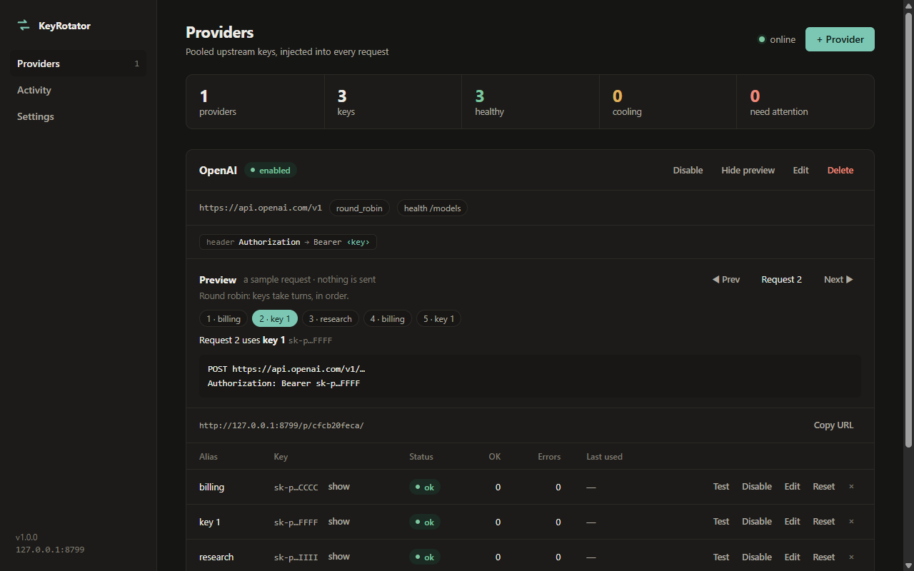
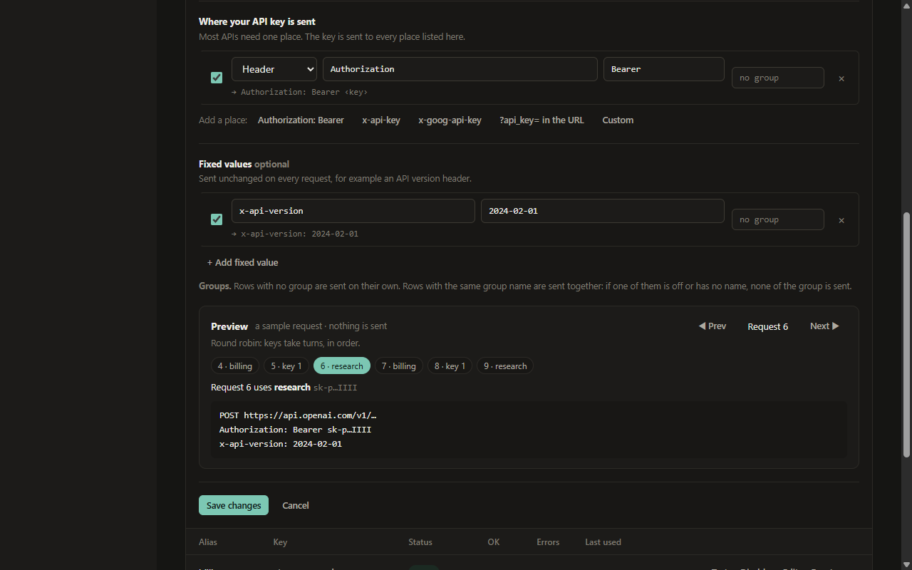

# KeyRotator

**One local URL for all your API keys.**

KeyRotator sits between your code and an API such as OpenAI or Anthropic. Your code sends requests to
KeyRotator, and KeyRotator adds the next healthy key from your pool. If a key gets rate-limited or
rejected, it quietly retries with another one, and a small dashboard shows you what happened.

<p align="center">
  
</p>

- **Spread the load.** Several keys share the traffic, so one key's rate limit doesn't stop you.
- **Keep keys out of your apps.** Your code talks to `http://127.0.0.1:8787`. The real keys live in one place.
- **Recover on its own.** A key that hits a rate limit rests and comes back. A revoked key is set aside.

It runs on Windows, macOS and Linux as a single small program, with nothing else to install.

## Quick start

**1. Build it** (needs [Go](https://go.dev/dl/) 1.24 or newer):

```sh
./scripts/build.sh                                              # macOS and Linux
powershell -ExecutionPolicy Bypass -File .\scripts\build.ps1    # Windows
```

**2. Start it** in the background, so it keeps running after you close the terminal:

```sh
./bin/keyrotator start          # Windows: .\bin\keyrotator.exe start
```

Then open the dashboard at <http://127.0.0.1:8787/>.

**3. Add a provider and your keys.** Click **+ Provider** in the dashboard and paste your keys, or use
the terminal:

```sh
./bin/keyrotator add OpenAI https://api.openai.com/v1
./bin/keyrotator add-key OpenAI sk-your-first-key --label billing
./bin/keyrotator add-key OpenAI sk-your-second-key
./bin/keyrotator url OpenAI     # prints the URL your code should use
```

A key you add without a name is called `key 1`, `key 2`, and so on.

## Use it from your code

`keyrotator url OpenAI` prints a URL like `http://127.0.0.1:8787/p/3f9a2c1b7e/`. Use it wherever your
code expects the API's base URL. Your code doesn't need a real key: KeyRotator replaces whatever key the
client sends with one from the pool.

**Python, with the OpenAI SDK**

```python
from openai import OpenAI

client = OpenAI(
    base_url="http://127.0.0.1:8787/p/3f9a2c1b7e/",
    api_key="not-used",  # KeyRotator puts a real key here
)

reply = client.chat.completions.create(
    model="gpt-4o-mini",
    messages=[{"role": "user", "content": "Say hi"}],
)
print(reply.choices[0].message.content)
```

Streaming responses pass straight through, so `stream=True` works as usual.

**JavaScript, with fetch**

```js
const res = await fetch("http://127.0.0.1:8787/p/3f9a2c1b7e/chat/completions", {
  method: "POST",
  headers: { "Content-Type": "application/json" },
  body: JSON.stringify({
    model: "gpt-4o-mini",
    messages: [{ role: "user", content: "Say hi" }],
  }),
});

console.log(res.headers.get("X-Rotator-Key")); // which key answered, e.g. "billing"
console.log((await res.json()).choices[0].message.content);
```

**curl, with Anthropic**

Anthropic wants the key in an `x-api-key` header plus a version header. You describe that once, when
you create the provider, and every request gets both:

```sh
curl http://127.0.0.1:8787/api/providers -H "Content-Type: application/json" -d '{
  "name": "Anthropic",
  "baseUrl": "https://api.anthropic.com/v1",
  "inject": [
    { "enabled": true, "in": "header", "name": "x-api-key", "source": "key" },
    { "enabled": true, "in": "header", "name": "anthropic-version", "source": "static", "value": "2023-06-01" }
  ]
}'
./bin/keyrotator add-key Anthropic sk-ant-your-key

curl "$(./bin/keyrotator url Anthropic)messages" -H "Content-Type: application/json" -d '{
  "model": "claude-sonnet-5-5",
  "max_tokens": 200,
  "messages": [{ "role": "user", "content": "Say hi" }]
}'
```

You can set up the same thing in the dashboard: edit the provider, click **x-api-key** under *Add a
place*, and add `anthropic-version` under *Fixed values*. On Windows PowerShell, run the curl examples
in Git Bash or WSL, or use the dashboard instead.

## How it works

```
your code ──► KeyRotator (127.0.0.1:8787) ──► the real API
                 │
                 ├─ picks the next key: round robin, random, or least recently used
                 ├─ 429, 5xx or no answer → that key rests for a while, another key retries
                 └─ 401 or 403 → that key is set aside, another key retries
```

A set-aside key comes back on its own once a background health check passes, or when you reset it.

Each provider says where its key goes (for example `Authorization: Bearer <key>` or `?api_key=<key>`)
and which fixed values to send with it. The editor shows the exact request your settings produce,
with **Prev / Next** buttons that step through which key each request will use. Nothing is sent
while you preview.

<p align="center">
  
</p>

## What else it does

- **Three ways to manage it:** the web dashboard, a [command line](docs/terminal.md), and a full-screen
  terminal UI (`keyrotator tui`) that also works over SSH.
- **Rate limits** per provider and per key, so you stay under each key's quota.
- **A proxy token,** so only clients you give the URL to can use your keys.
- **Key aliases and pinning.** Name keys, and send `X-Rotator-Key: billing` to use one key on purpose.
- **Groups of fields** that are only sent together. See [configuration](docs/configuration.md#fields-that-go-together-groups).
- **Runs on its own:** start at login on Windows, macOS and Linux, as a Windows service, or in Docker.
- **Prometheus metrics** at `/metrics`.

## Learn more

| Guide | What's inside |
| --- | --- |
| [Running it](docs/running.md) | Background mode, start at login, Windows service, systemd, Docker, command-line flags |
| [From the terminal](docs/terminal.md) | Every CLI command, and the terminal UI's keys |
| [Configuration](docs/configuration.md) | How keys are chosen, where they are sent, groups, aliases, proxy token, rate limits, security |
| [HTTP API and metrics](docs/api.md) | The JSON API behind the dashboard, response headers, Prometheus metrics |

## Security in a minute

- KeyRotator only listens on `127.0.0.1` unless you change it.
- Keys are stored in plain text in your config file, which only your user can read. Use keys you can revoke.
- Before you open the port to other machines, set a proxy token and an admin token in **Settings**.
  KeyRotator warns at startup if you don't.

## Contributing

Bug reports and pull requests are welcome. [CONTRIBUTING.md](CONTRIBUTING.md) explains how to build,
test and find your way around the code. Please report security problems privately, as described in
[SECURITY.md](SECURITY.md).

## License

[MIT](LICENSE)
